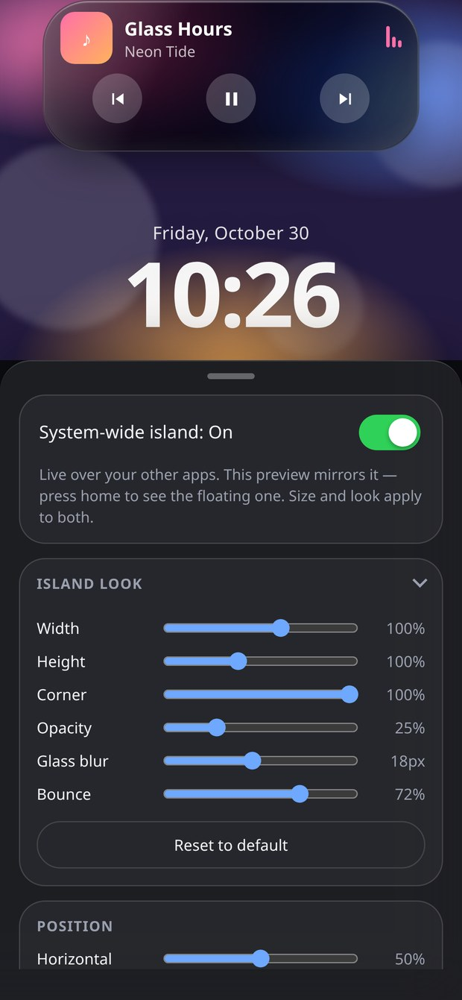
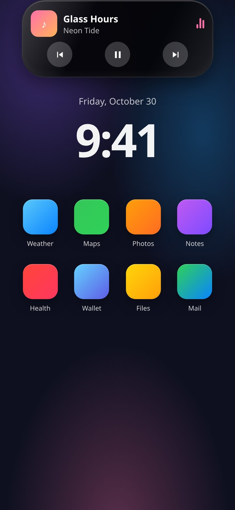
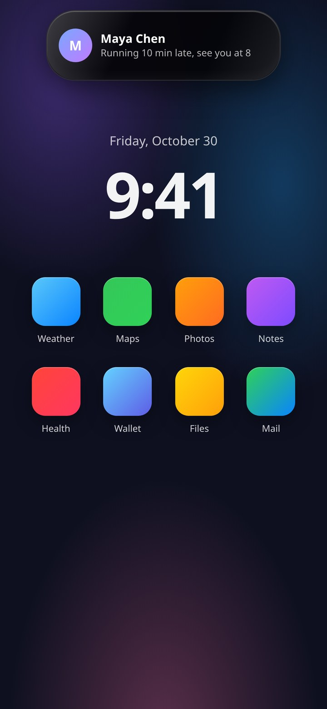

# Dynamic Island · Liquid Glass

A Dynamic Island that actually lives on your screen. Flip the switch and it floats above every app
until you flip it back; flip it off and it is gone. It started as a single HTML mockup — this repo is
that mockup with its bugs fixed, rebuilt as a real Android app with a real system overlay, and shipped
as a signed APK.

**[⬇ Download the APK](https://github.com/technicalnihilist-lgtm/dynamic-island/releases/latest)** ·
Android 7.0+ · 102 KB · no internet permission

  

## System-wide, on and off

The switch in the app is the whole story:

- **Off** — the island lives inside this app only. That is the preview, where you can poke at every
  state and tune the size and the glass.
- **On** — a foreground service puts the island in a `TYPE_APPLICATION_OVERLAY` window above
  everything else. Press home, open a game, read your mail: it stays.
- Turning it off tears the window down immediately. No background process is left behind.

The preview does not disappear when you switch it on. It stays exactly where it was, showing the same
state and the same size, so the sliders always have something to act on — and whatever you change
applies to both. While this app is on screen the floating window detaches itself, so you never see two
islands stacked on each other and the overlay never eats a touch meant for the app underneath. The
moment you leave, the floating one takes over, and any state it moved to (a notification arriving, a
tap on the island) is mirrored back into the preview when you return.

Android will not let any app do this without permission, so the first time you switch it on the app
sends you to **Display over other apps** and comes back once you have granted it.

**Optional but recommended: notification access.** With it, real notifications show up in the island —
app, sender, message — for seven seconds, then it collapses back to the pill. A ringing call gets the
incoming-call view instead, with the same green and red buttons as the demo, wired to the answer and
decline actions of whichever phone app you use. Without it the island
still works; it just has nothing to report. Nothing leaves your device: there is no network code in
this app at all.

## What it does

The island is a spring simulation, not a CSS transition. Width, height, corner radius and scale each
run their own damped spring, so a morph squashes, overshoots and settles instead of easing in a
straight line. The **Bounce** slider changes the damping ratio of those springs live.

States: idle, incoming call, outgoing call, a live call with a running timer, now playing, and a
notification. Tap the island to open or collapse it, tap the wallpaper to collapse it, or drive it
from the sheet at the bottom — which drives the floating island too when it is on.

- Real glass in the app (`backdrop-filter` blur + saturation over the wallpaper, with an inset
  specular highlight). Over other apps the island is a solid near-black pill, because Android gives
  no app the ability to blur another app's pixels — pretending otherwise would be a lie.
- Controls that stay out of the way — the sheet collapses to a grabber for a full-screen island
- Opacity, blur, corner, width, height and bounce are adjustable and remembered between launches
- Haptics on every state change, a working hardware back button, edge-to-edge layout with the real
  status-bar inset, and the real battery level in the status line
- Dark and light themes, and full `prefers-reduced-motion` support

## Install

Download `DynamicIsland-1.5.0.apk` and open it. Android will ask you to allow installs from your
browser or file manager — normal for anything that is not from the Play Store. The APK is signed
(v2 + v3) and targets Android 14 (API 34), minimum Android 7.0 (API 24).

| Permission | Why |
| --- | --- |
| Display over other apps | the floating island itself |
| Notification access | optional: mirrors notifications, gives the incoming-call view its green and red buttons, and lets the island read and control the playing song |
| Post notifications | the foreground-service notice that Android requires while the overlay runs |
| Vibrate | haptics |

Any earlier version installs straight over the top — same signing key.

## Bugs fixed

The original mockup looked right in a screenshot but misbehaved when you used it. Everything below was
reproduced, fixed and covered by `tools/test_app.py` (77 checks, all passing).

### 1.5.0 — higher, on the lock screen, and it runs your music

1. **Position reaches the absolute top.** Vertical 0% is now y = 0 — the island can sit over the
   status bar, not just under it — and the whole range is live in both the preview and the floating
   window.
2. **It shows on the lock screen.** The overlay window carries `FLAG_SHOW_WHEN_LOCKED`, with a
   "Show on lock screen" switch in the Position card so you can turn it off. Honest caveat: whether an
   overlay may join the keyguard is up to the OEM, so on some phones the lock screen still wins.
3. **Real music, not a demo.** With notification access the app reads the active `MediaSession` — the
   same mechanism the system's own media controls use — and puts the playing song's title and artist in
   the island with previous / play-pause / next. Those three buttons drive the actual player through
   `TransportControls`, so pause really pauses and next really skips. When the player goes away the
   island collapses. The demo still works when nothing is playing.
4. **Bouncier morph.** Default bounce is up to 72%, and every state change now gets a velocity kick in
   the direction of travel, so a big jump overshoots more than a small one instead of every morph
   feeling the same.
5. Fixed on the way: the play/pause button's `aria-label` did not follow its icon after a tap.

### 1.4.0 — put it anywhere, and answer real calls from it

6. **Position is yours now.** Two sliders — horizontal and vertical, 0–100% — place the island
   anywhere on the screen. They drive the preview *and* the floating window from the same numbers, so
   what you set is what you get out there, and the choice is remembered. 50% / 0% is centred at the
   very top.
7. **A real incoming call now gets the demo's buttons.** The notification listener recognises
   `CATEGORY_CALL` notifications and switches the island to the incoming-call view — the same green
   accept and red decline circles as the demo, same phone glyph, no text labels — with the caller's
   name and line from the notification. The two buttons fire the dialer's *own* answer and decline
   actions, taken straight out of that notification, so it works with whichever phone app you use and
   needs no extra permission beyond notification access. When the call notification goes away the
   island collapses on its own.

### 1.3.0 — it actually runs over other apps now, at the top

8. **The overlay never stayed on screen.** The hand-off between the app and the floating window was
   inverted: `onPause` — which fires the moment you leave the app — *detached* the window, and
   `onResume` attached it. So switching it on and pressing home made the island vanish, which is
   exactly when it should have appeared. The two calls are now one method with an unambiguous name,
   `setHostInForeground(boolean)`, and the service also checks a `VISIBLE` flag when it starts so the
   window never flashes over the app you just turned it on from.
9. **The island sat 40dp down the screen.** The app was drawing its own fake status bar underneath the
   real Android one — two clocks, two battery icons — and parked the island below that. The fake bar is
   gone and the island now hugs the top edge, at the status-bar inset + 2dp. The overlay window does
   the same: `y = statusBarHeight + 2dp` with the island at 0 inside it.
10. **The overlay window could keep its default size.** `resize` bailed out whenever the view was
   detached, so a window that started while the app was in front never picked up the island's real
   size. The size is now always kept current and only the `updateViewLayout` call is gated.
11. **Failures were silent.** If the window could not be added — permission revoked mid-flight, an OEM
   blocking overlays, a bad token — the service just stopped and the app showed "On" over nothing. The
   reason is now carried back into the app and printed under the switch.

### 1.2.0 — the settings that vanished, and a bigger island

12. **The size controls could disappear.** The sheet is a flex column, and flex children shrink by
   default. Once the content was taller than the sheet, the tallest card — the one holding width,
   height, corner, opacity, blur and bounce — was squeezed to a 2px sliver instead of the sheet
   scrolling. Everything else looked fine, which is what made it so confusing. Fixed with
   `flex: 0 0 auto` on the sheet's children, and there is now a test that asserts the controls keep
   their height on a 640px-tall screen and are still reachable by scrolling.
13. **The island was too small.** Base geometry up about 16% (idle 112×32 → 130×38, now playing
   276×112 → 318×128), type up a notch, controls up from 38 to 42dp, and the width/height sliders now
   reach 60–125% and 70–150% so you can go bigger still.
14. **The preview used to vanish when you switched the overlay on**, leaving you tuning something you
   could not see. It stays now, and the floating window detaches itself while the app is in front —
   detached rather than hidden, because a hidden overlay window still swallows touches.
15. **The overlay could be stranded mid-morph** when frames were throttled, and it would then report a
   stale size to the native window, clipping the island. It has the same 1.5s settle watchdog the app
   has had since 1.0.0.
16. **The wallpaper clock could sit under a tall island.** It is now measured against the space it
   actually has, so it shrinks instead of sliding under the island.

### 1.1.0 — going system-wide

17. The island is a real overlay window now, not a page inside the app. The window is sized to exactly
   the island's current box and grown *before* each morph, so nothing is ever clipped mid-animation
   and the overlay never swallows touches it does not need.
18. The overlay island had no `box-sizing: border-box`, so its 1px border made it render 2px wider than
   the size it reported to the native window — which then clipped the border. Caught by the geometry
   assertions, fixed at the source.
19. The switch used to mean "is the preview drawn". It now means "is the island running over other
   apps", and it is the single source of truth: the label, the accessibility state, the preview, the
   service and `localStorage` are all driven from one function instead of five places drifting apart.
20. Permission was assumed rather than checked. Toggling without it silently did nothing; now it opens
   the right settings screen, stays off, and explains why.
21. The service could be left running with the switch showing "Off" after a reboot or a low-memory
   kill. The app re-syncs on resume and restarts the service if the switch is on.

### 1.0.0 — the original seventeen

**Things that visibly broke**

22. The activity chips declared `font: 500 14px inherit` — not a legal shorthand, so the entire
   declaration was thrown away and every chip rendered at the browser default 13.3px/400 instead of
   14px/500. Replaced with explicit `font-family`/`font-size`/`font-weight`.
23. Tapping the island after closing a live call reopened an *incoming call* rather than the call you
   were on: the "remember last state" line mapped `ongoing` to `incoming`. It now stores the real
   previous state.
24. Switching away from **Call someone** within 3.6 seconds could still drop you into a live call. The
   auto-promote `setTimeout` shared a variable with the call-duration `setInterval` and was cancelled
   with `clearInterval`, which is not a reliable way to cancel a timeout. Every timer now has its own
   handle plus a state guard.
25. Two quick state changes could leave the island **empty and invisible**: `clearTimeout` cancelled the
   pending "fade the contents back in", stranding the `.out` class. Swaps are token-guarded now and the
   visible state is always restored.
26. Turning the island off mid-call left the duration interval and the promote timer running forever,
    and left `pointer-events` / `aria-hidden` out of sync with the switch.
27. Play/pause wrote to `content.firstChild` and next/previous searched the island for the first `.t1` —
    both silently target the wrong node after a re-render. Every lookup is scoped to the current view.
28. The huge wallpaper clock used to bleed through the island text. The clock is now centred in the
    space *below* the island, and the default island opacity went from 44% to 75%.
29. White text on the light-blue "active" chip was about 2.2:1 contrast — barely readable. It is dark
    ink on the accent now, around 7:1.

**Things that broke under the hood**

30. The corner-radius target could exceed half the height; the render loop clamped it silently, so the
    morph snapped at the very end. The target is clamped before it reaches the spring.
31. All motion was driven by `requestAnimationFrame` alone. In a backgrounded tab that pauses, leaving
    the island stranded mid-morph and the contents never faded in. Contents now fade on a timer, and a
    1.5 s watchdog snaps any spring that has not finished.
32. The clock and date were hardcoded strings ("9:41", "Friday, October 30"). They are live now.
33. `prefers-reduced-motion` only stopped the wallpaper orbs; the waveform, equaliser and pulse ring
    kept animating. All of it stops now.
34. Settings reset on every reload — they persist in `localStorage` now.
35. The accordion measured `offsetHeight` on every frame and animated `height` in pixels, which broke
    after a rotation or a font-size change. It is a pure-CSS `max-height` transition now.
36. The island carried `role="button"` while containing real buttons — nested interactive elements,
    which screen readers announce badly. The container is a `role="group"`; the controls keep their own
    roles, labels and `aria-pressed` state, and state changes are announced in a live region.
37. No `theme-color`, no safe-area handling for the notch or the gesture bar, no `touch-action`, so taps
    were delayed ~300 ms on some devices.

## Build the APK yourself

No Gradle. `build.sh` drives `aapt2`, `javac`, `d8`, `zipalign` and `apksigner` directly, which keeps
the build to a few seconds and the repo to a few hundred KB.

```bash
# needs JDK 17+ and Android SDK build-tools 34 + platform android-34
export ANDROID_HOME="$HOME/Android/Sdk"
./app/build.sh
# -> app/dist/DynamicIsland-1.5.0.apk
```

`build.sh` copies `app/index.html` and `app/overlay.html` into the Android assets folder itself, so the
web app has exactly one source of truth. GitHub Actions runs the same script on every push
(`.github/workflows/build.yml`) and uploads the APK as an artifact.

## Run the web version

Open `app/index.html` in any browser — no bundler, no dependencies, no `npm install`. The system-wide
switch needs the Android shell, so in a browser it stays off; everything else works. `app/overlay.html`
is the floating island on its own and can be opened directly to see what the overlay looks like.

## Tests

```bash
pip install playwright && playwright install chromium
python tools/test_app.py
```

77 checks against a real browser: geometry per state, the island at the absolute top, the position
sliders moving it to every edge, the lock-screen switch, content visibility, timer ticking,
mute/pause/next, the system-wide switch (permission handling, service start/stop, the preview staying
put, chips and sliders reaching the overlay, state mirroring in both directions), accordion, sheet,
back-button order, persistence, a rapid state-thrash test, the size controls surviving a 640px-tall
screen, a broken overlay being reported instead of swallowed, and the overlay page itself — transparent
body, size reporting, max-width handling, notification arrival and auto-dismiss, tap-to-collapse, a real
call arriving with exactly one green and one red unlabelled button that fire the right action, and a real
song whose pause, next and previous reach the player.

## Project layout

```
app/index.html                         the control room: preview, switch, settings
app/overlay.html                       the floating island, rendered in the overlay window
app/android/AndroidManifest.xml        one activity, one foreground service, one listener
app/android/src/.../MainActivity.java  WebView shell: insets, battery, haptics, back, permissions
app/android/src/.../IslandService.java the overlay window: sizing, state, notification channel
app/android/src/.../NotifListener.java optional notification mirroring
app/android/res/                       theme, gradient background, launcher icon, status icon
app/build.sh                           the whole build pipeline
keystore/                              signing key, base64 encoded (see below)
tools/test_app.py                      Playwright run against both pages
dist/                                  prebuilt signed APK
```

## About the signing key

`keystore/dynamic-island.jks.base64` is the throwaway key the released APK is signed with, published
on purpose so that future releases can be installed as updates over this one (Android refuses an update
signed with a different key). It is not a secret and it protects nothing. `build.sh` decodes it if
`keystore/dynamic-island.jks` is missing, and generates a fresh key if that is missing too.

```bash
base64 -d keystore/dynamic-island.jks.base64 > keystore/dynamic-island.jks
# storepass / keypass: dynamicisland   alias: dynamicisland
```

If you fork this and publish your own build, generate your own key — do not sign with this one.

## License

MIT. Do what you like with it.
