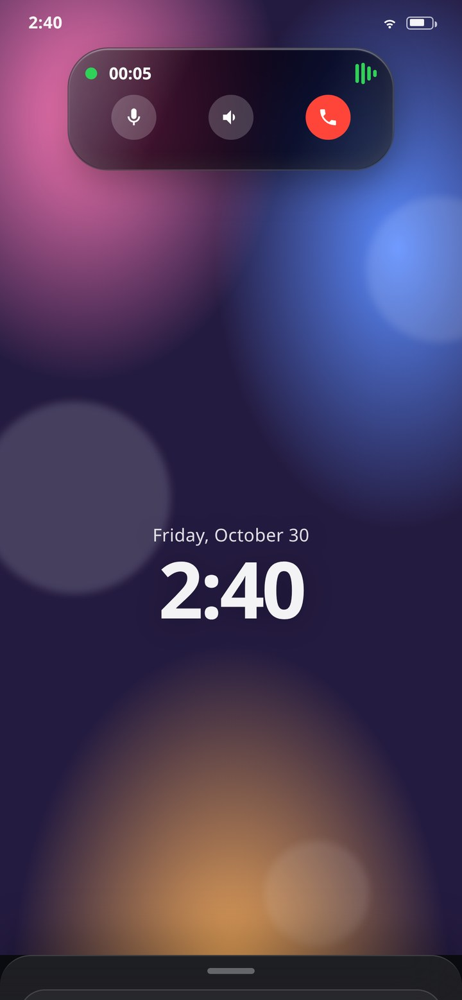
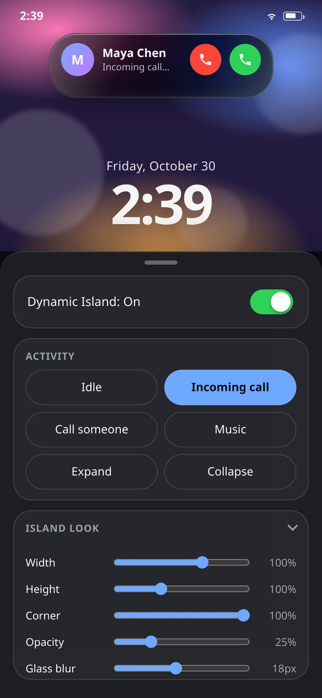
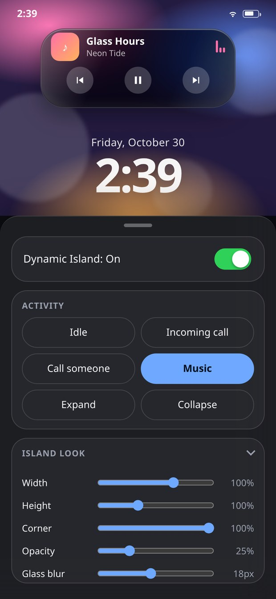

# Dynamic Island · Liquid Glass

A Dynamic Island you can actually poke. It started life as a single HTML mockup; this repo is that
mockup with its bugs fixed, rebuilt as a real Android app, and shipped as a signed APK.

**[⬇ Download the APK](https://github.com/technicalnihilist-lgtm/dynamic-island/releases/latest)** ·
[`dist/DynamicIsland-1.0.0.apk`](dist/DynamicIsland-1.0.0.apk) · Android 7.0+ · 90 KB · no permissions except vibration

  

## What it does

The island is a spring simulation, not a CSS transition. Width, height, corner radius and scale each
run their own damped spring, so a morph squashes, overshoots and settles instead of easing in a
straight line. The **Bounce** slider changes the damping ratio of those springs live.

Five states: idle, incoming call, outgoing call, a live call with a running timer, and now playing.
Tap the island to open or collapse it, tap the wallpaper to collapse it, or drive it from the sheet at
the bottom.

- Real glass: `backdrop-filter` blur + saturation over the wallpaper, with an inset specular highlight
- Controls that stay out of the way — the sheet collapses to a grabber for a full-screen island
- Opacity, blur, corner, width, height and bounce are all adjustable, and remembered between launches
- Haptics on every state change, a working hardware back button, edge-to-edge layout with the real
  status-bar inset, and the real battery level in the status line
- Dark and light themes, and full `prefers-reduced-motion` support

## Install the APK

Download `DynamicIsland-1.0.0.apk` and open it. Android will ask you to allow installs from your
browser or file manager — that is normal for any app that does not come from the Play Store.
The APK is signed (v2 + v3) and targets Android 14 (API 34), minimum Android 7.0 (API 24).

No internet permission, no analytics, no network code at all. The whole app is one local HTML file.

## Run the web version

Open `app/index.html` in any modern browser. There is nothing to build — no bundler, no dependencies,
no `npm install`. It works offline and can be added to a home screen as a PWA.

## Bugs fixed

The original mockup looked right in a screenshot but misbehaved when you used it. Everything below was
reproduced, fixed and covered by the test run in `tools/test_app.py` (37 checks, all passing).

**Things that visibly broke**

1. The activity chips declared `font: 500 14px inherit` — not a legal shorthand, so the entire
   declaration was thrown away and every chip rendered at the browser default 13.3px/400 instead of
   14px/500. Replaced with explicit `font-family`/`font-size`/`font-weight`.
2. Tapping the island after closing a live call reopened an *incoming call* rather than the call you
   were on: the "remember last state" line mapped `ongoing` to `incoming`. It now stores the real
   previous state.
3. Switching away from **Call someone** within 3.6 seconds could still drop you into a live call. The
   auto-promote `setTimeout` shared a variable with the call-duration `setInterval` and was cancelled
   with `clearInterval`, which is not a reliable way to cancel a timeout. Every timer now has its own
   handle plus a state guard.
4. Two quick state changes could leave the island **empty and invisible**: `clearTimeout` cancelled the
   pending "fade the contents back in", stranding the `.out` class. Swaps are token-guarded now and the
   visible state is always restored.
5. Turning the island off mid-call left the duration interval and the promote timer running forever,
   and left `pointer-events` / `aria-hidden` out of sync with the switch. Power now clears every timer
   and drives the switch label, the pointer state and the accessibility state from one place.
6. Play/pause wrote to `content.firstChild` and next/previous searched the island for the first `.t1` —
   both silently target the wrong node after a re-render. Every lookup is scoped to the current view.
7. The huge wallpaper clock used to bleed through the island text. The clock is now centred in the
   space *below* the island, and the default island opacity went from 44% to 75%.
8. White text on the light-blue "active" chip was about 2.2:1 contrast — barely readable. It is dark
   ink on the accent now, around 7:1.

**Things that broke under the hood**

9. The corner-radius target could exceed half the height; the render loop clamped it silently, so the
   morph snapped at the very end. The target is clamped before it reaches the spring.
10. All motion was driven by `requestAnimationFrame` alone. In a backgrounded tab that pauses, leaving
    the island stranded mid-morph and the contents never faded in. Contents now fade on a timer, and a
    1.5 s watchdog snaps any spring that has not finished.
11. The clock and date were hardcoded strings ("9:41", "Friday, October 30"). They are live now.
12. `prefers-reduced-motion` only stopped the wallpaper orbs; the waveform, equaliser and pulse ring
    kept animating. All of it stops now.
13. Settings reset on every reload — they persist in `localStorage` now.
14. The accordion measured `offsetHeight` on every frame and animated `height` in pixels, which broke
    after a rotation or a font-size change. It is a pure-CSS `max-height` transition now.
15. The island carried `role="button"` while containing real buttons — nested interactive elements,
    which screen readers announce badly. The container is a `role="group"`; the controls keep their own
    roles, labels and `aria-pressed` state, and state changes are announced in a live region.
16. No `theme-color`, no safe-area handling for the notch or the gesture bar, no `touch-action`, so taps
    were delayed ~300 ms on some devices.

**Added on the way**

Haptic feedback, hardware back-button handling (collapse the island → restore the sheet → exit),
edge-to-edge rendering with the real system insets passed in from the native shell, the real battery
level, a reset button, the collapsible sheet, and a proper adaptive launcher icon.

## Build the APK yourself

No Gradle. `build.sh` drives `aapt2`, `javac`, `d8`, `zipalign` and `apksigner` directly, which keeps
the build to a few seconds and the repo to a few hundred KB.

```bash
# needs JDK 17+ and Android SDK build-tools 34 + platform android-34
export ANDROID_HOME="$HOME/Android/Sdk"
./app/build.sh
# -> app/dist/DynamicIsland-1.0.0.apk
```

`build.sh` copies `app/index.html` into the Android assets folder itself, so the web app has exactly
one source of truth. GitHub Actions runs the same script on every push (`.github/workflows/build.yml`)
and uploads the APK as an artifact.

## Project layout

```
app/index.html                         the entire web app: markup, CSS, state machine
app/android/AndroidManifest.xml        one activity, portrait, VIBRATE and nothing else
app/android/src/.../MainActivity.java  WebView shell: insets, battery, haptics, back button
app/android/res/                       theme, gradient background, launcher icon
app/build.sh                           the whole build pipeline
keystore/                              signing key, base64 encoded (see below)
tools/test_app.py                      Playwright run against the web app
dist/                                  prebuilt signed APK
```

## About the signing key

`keystore/dynamic-island.jks.base64` is the throwaway key the released APK is signed with, published
on purpose so that future releases can be installed as updates over this one (Android refuses an update
signed with a different key). It is not a secret and it protects nothing. `build.sh` decodes it if
`keystore/dynamic-island.jks` is missing, and generates a fresh key if that is missing too.

```bash
base64 -d keystore/dynamic-island.jks.base64 > keystore/dynamic-island.jks
# storepass / keypass: dynamicisland   alias: dynamicisland
```

If you fork this and publish your own build, generate your own key — do not sign with this one.

## License

MIT. Do what you like with it.
