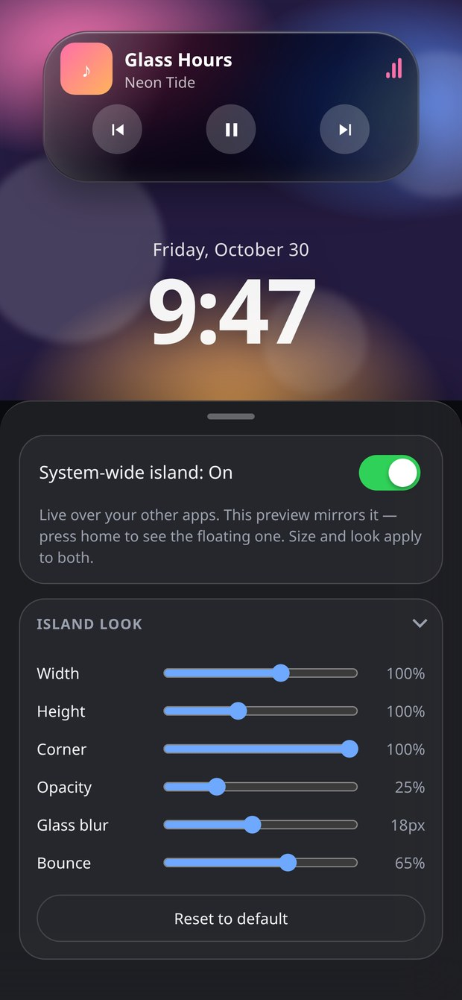
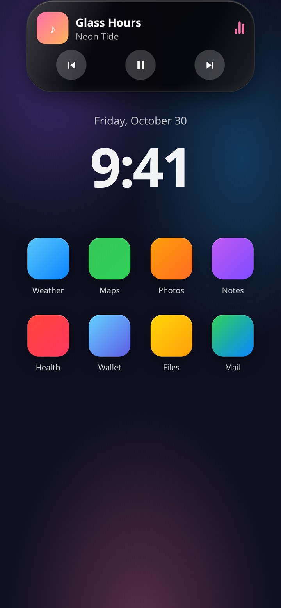
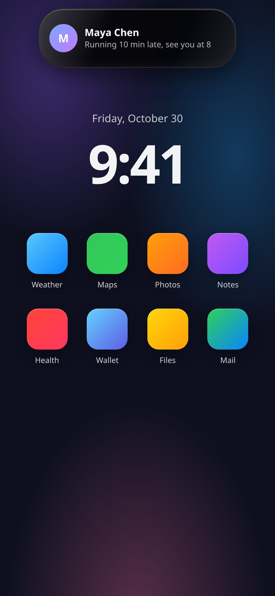

# Dynamic Island · Liquid Glass

A Dynamic Island that actually lives on your screen. Flip the switch and it floats above every app
until you flip it back; flip it off and it is gone. It started as a single HTML mockup — this repo is
that mockup with its bugs fixed, rebuilt as a real Android app with a real system overlay, and shipped
as a signed APK.

**[⬇ Download the APK](https://github.com/technicalnihilist-lgtm/dynamic-island/releases/latest)** ·
Android 7.0+ · 102 KB · no internet permission

  

## System-wide, on and off

The switch in the app is the whole story:

- **Off** — the island lives inside this app only. That is the preview, where you can poke at every
  state and tune the size and the glass.
- **On** — a foreground service puts the island in a `TYPE_APPLICATION_OVERLAY` window above
  everything else. Press home, open a game, read your mail: it stays.
- Turning it off tears the window down immediately. No background process is left behind.

The preview does not disappear when you switch it on. It stays exactly where it was, showing the same
state and the same size, so the sliders always have something to act on — and whatever you change
applies to both. While this app is on screen the floating window detaches itself, so you never see two
islands stacked on each other and the overlay never eats a touch meant for the app underneath. The
moment you leave, the floating one takes over, and any state it moved to (a notification arriving, a
tap on the island) is mirrored back into the preview when you return.

Android will not let any app do this without permission, so the first time you switch it on the app
sends you to **Display over other apps** and comes back once you have granted it.

**Optional but recommended: notification access.** With it, real notifications show up in the island —
app, sender, message — for seven seconds, then it collapses back to the pill. A ringing call gets the
incoming-call view instead, with the same green and red buttons as the demo, wired to the answer and
decline actions of whichever phone app you use. Without it the island
still works; it just has nothing to report. Nothing leaves your device: there is no network code in
this app at all.

## What it does

The island is a spring simulation, not a CSS transition. Width, height, corner radius and scale each
run their own damped spring, so a morph squashes, overshoots and settles instead of easing in a
straight line. The **Bounce** slider changes the damping ratio of those springs live.

States: idle, incoming call, outgoing call, a live call with a running timer, now playing, and a
notification. Tap the island to open or collapse it, tap the wallpaper to collapse it, or drive it
from the sheet at the bottom — which drives the floating island too when it is on.

- Real glass in the app (`backdrop-filter` blur + saturation over the wallpaper, with an inset
  specular highlight). Over other apps the island is a solid near-black pill, because Android gives
  no app the ability to blur another app's pixels — pretending otherwise would be a lie.
- Controls that stay out of the way — the sheet collapses to a grabber for a full-screen island
- Opacity, blur, corner, width, height and bounce are adjustable and remembered between launches
- Haptics on every state change, a working hardware back button, edge-to-edge layout with the real
  status-bar inset
- Dark and light themes, and full `prefers-reduced-motion` support

## Install

Download `DynamicIsland-1.7.0.apk` and open it. Android will ask you to allow installs from your
browser or file manager — normal for anything that is not from the Play Store. The APK is signed
(v2 + v3) and targets Android 14 (API 34), minimum Android 7.0 (API 24).

| Permission | Why |
| --- | --- |
| Display over other apps | the floating island itself |
| Notification access | optional: mirrors notifications, gives the incoming-call view its green and red buttons, and lets the island read and control the playing song |
| Post notifications | the foreground-service notice that Android requires while the overlay runs |
| Vibrate | haptics |

Any earlier version installs straight over the top — same signing key.

## Bugs fixed

The original mockup looked right in a screenshot but misbehaved when you used it. Everything below was
reproduced, fixed and covered by `tools/test_app.py` (210 checks, all passing). The 1.7.16 entry is in
the Android service rather than in the page, so the page suite is untouched by it.

### 1.7.24 — optimisation slot 2

1. **Controls that were hidden were still live for the keyboard and for a screen reader.** The sheet
   collapses by clipping itself to its 38 px handle, and the look accordion closes by taking its panel
   to `max-height: 0`. Neither did anything to the tab order or to the accessibility tree, so every
   control in them stayed exactly as reachable as it was when open. With the accordion shut, Tab walked
   through six sliders and a Reset button that measured zero pixels tall and drew nothing; with the
   sheet collapsed, the same held for the whole control room — the system-wide switch, five activity
   chips, three links and both position sliders. TalkBack announced all of them and would operate them
   if you swiped to one, so a blind user could change settings through controls a sighted user cannot
   see, and a keyboard user's focus ring disappeared into a clipped box with no way to tell where it
   had gone. Both regions now go `inert` when they are hidden and come back when they are shown: out of
   the tab order, out of the accessibility tree, and untouched in layout, paint and transition, so the
   page looks exactly as it did. The grab handle and the accordion header stay reachable, so either can
   still be opened again from the keyboard; where the WebView predates `inert` the attribute is set
   instead and simply ignored, which is the behaviour the page had before. Sixteen new browser checks
   cover both regions in both directions and assert that nothing in a collapsed region is left in the
   focus order; five of them fail against the old page.

### 1.7.23 — optimisation slot 4

1. **A tap just after the island had finished morphing had its animation snapped away.** `armSettle()`
   arms a 1.5 s backstop that forces the springs to their target, for the case where frames stop
   arriving — a throttled window, a screen that went off — so the island can never be stranded at an
   in-between size. Nothing cancelled it when the loop settled on its own, which it does in about half
   a second, so every morph left a live timer behind for the remaining second. A tap in that window
   that starts a small wobble of its own is not a state change and arms nothing of its own: Next and
   Previous nudge the width, Play and Mute nudge the height, and opening the island does both. Those
   inherited the stale timer, and at 1.5 s it fired in the middle of them — the springs were snapped
   to their target and the island jumped the last few pixels instead of easing into them. Both pages
   had it, so the preview and the floating island jumped together. The backstop is now disarmed the
   moment the springs come to rest, which is the moment it has nothing left to do; when frames really
   do stop, `frame()` never runs, so the timer survives and still does its job. Nothing moves that did
   not move before — the same morph, the same wobble, the same final size; only the truncation is gone.
   Four new browser checks drive the loop by hand through the existing fake `requestAnimationFrame`:
   morph, settle, nudge, one frame, then a real 1.7 s wait — the width must still be where the nudge
   left it (318.84 px) and not back at the settled 318.00 px.

### 1.7.22 — optimisation slot 6

1. **The floating island threw away the look you set whenever its page was not ready to hear it.**
   `applyConfig` handed the four numbers — width, height, corner, bounce — straight into the WebView
   and returned early, dropping them on the floor, if the page had not yet called `ready()`. The page
   pushes that configuration 700 ms after the switch goes on, which is a guess: on a cold start, on a
   slow phone, or on a device whose WebView takes a second to come up, the push lands first and the
   numbers are gone. The page then booted with its own defaults, reported its size, and the island ran
   at 100% width and height for the rest of the session while the preview in the app showed the size
   that had been set — the two disagreed until a slider was touched again, and the setting was never
   the cause. The same hole opened whenever the renderer was killed and rebuilt, which the service
   already handles for every other thing it pushes: the state, an incoming call and a notification are
   all held in a pending field and replayed the moment the new page says it is ready, and the look was
   the one that was not. It is held now too, and replayed with the rest. Nothing on screen changes
   where the page was already ready in time, which is every launch that worked before: the same four
   numbers reach the same four sliders. No new browser checks — the page is untouched and its 190 still
   pass. That a cold start really outruns the 700 ms push needs a device and logcat; it cannot be
   asserted from a browser, and the JDK/SDK download this sandbox needs to compile the service came
   back as a 504 from the proxy, so the change was checked by parser and by review rather than by
   `javac`.

### 1.7.21 — optimisation slot 2

1. **Reopening the app quietly switched the system-wide island off — and stopped it if it was
   running.** The page starts life with `sys = { canDraw:false, running:false, … }` and boot called
   `setPower(!!S.on, true)` before Android had been asked anything at all. With the switch stored as
   On, that call met `sys.canDraw === false`, decided the permission had been refused, set `S.on` to
   false *and saved it*, and turned the switch over. The `__sysState` push that arrives from
   `MainActivity.onResume` a moment later then found the exact disagreement its own logic is written
   to repair — "the stored setting says off, but the window is up" — and called `stopOverlay()`. So
   using the island, pressing Back and reopening the app killed the floating island, and the switch
   read Off from then on: the setting was gone for good, because the page's own `S.on` is the only
   record of it. The bridge already answers all three questions synchronously
   (`canDrawOverlays`, `overlayRunning`, `hasNotifAccess`) and the page never called any of them, so
   boot now reads them into `sys` before it decides anything. Where the answers agree with the old
   defaults — the first launch, and every launch with no permission — nothing changes; where they
   disagree, the switch now shows what is actually true, an island that survived the relaunch is
   left running instead of being stopped, and one that was killed with the process (a reboot, an OEM
   task cleaner) is started again, which is what `__sysState` was already trying to do. Nothing on
   screen changes: the same switch, the same hint, the same wording, driven by the real state instead
   of a default. `tools/test_app.py` gains 9 checks (181 → 190): with the switch stored as On and the
   island already up, boot asks the bridge, shows On, calls neither `startOverlay` nor `stopOverlay`
   and leaves the stored setting alone; the state push that follows keeps it running; with nothing
   running, the same stored On starts it again; and with the permission genuinely revoked it is
   still turned off and saved. Five of the nine fail against the old page.

### 1.7.20 — optimisation slot 1

1. **Clicking a slider, or nudging it with an arrow key, changed the island but never saved the
   setting.** A click on a range track and every arrow key on one deliver `input` and `change` in the
   same task, with no animation frame between them. The `change` handler saved the settings and pushed
   them to the service straight away, while the value itself was still sitting in a queued frame — so
   it stored the *previous* number and configured the floating island with that one. The preview grew
   to the size the slider showed, the saved setting did not, and the floating island kept the old size;
   the two disagreed until the app was restarted, at which point the look silently reverted. Only a
   drag behaved, and only because its `input` events are spread across frames, so the value always
   happened to be applied before the finger came up. The handler now applies the pending value before
   it saves or pushes it; `flush()` is idempotent, so a frame still in the queue finds the value
   already applied and does nothing. Nothing on screen changes — the same value reaches the same
   springs, a frame earlier at most. `tools/test_app.py` gains 6 checks (175 → 181): a click-style
   change to the width slider is stored as `1.18` and pushed to the service as `1.18` instead of `1`,
   a real ArrowRight press is stored as `1.01`, a click on the position slider is stored and sent, and
   a drag still stores where it ended. Five of the six fail against the old page; the sixth (the
   position push) already passed, because that slider's trailing 80 ms send repaired itself — only its
   persistence was broken.

### 1.7.19 — optimisation slot 8

1. **Revoking "Display over other apps" left the island unreachable by keyboard and invisible to a screen
   reader.** While the system-wide island is on, the in-app preview is a mirror of it rather than a
   control of its own, so it is taken out of the tab order and hidden from accessibility services —
   three lines inside `setPower`, which is what the switch calls. The other path that can turn the
   switch over is `__sysState`, the state push that arrives from Android, and it only turned the
   preview's touches back on. That path is exactly how a permission revoked in Android's own settings
   reaches the page: the app came back reporting the island off, hinting that it needed the permission,
   drawing the island live and accepting taps on it — while it still carried `tabindex="-1"` and
   `aria-hidden="true"` from when the floating island had been on. Tab skipped it, TalkBack never
   announced it, and only restarting the app put it back. Both paths now go through one
   `setIslandInteractive()` helper, so they cannot drift apart again. Nothing on screen changes: the
   three properties are focus order and accessibility metadata, not pixels. `tools/test_app.py` gains 6
   checks (169 → 175): with the island floating, the preview is off the tab order; revoking the
   permission turns the switch off and gives the preview back its tab stop, its `aria-hidden` and its
   place in sequential navigation, walked with real Shift+Tab presses rather than a programmatic
   `.focus()` — which succeeds even at `tabindex="-1"` and would have proved nothing. Two of the six
   fail against the old page. What a real TalkBack does with the same DOM needs a device; the page is
   measured here.

### 1.7.18 — optimisation slot 7

1. **Every morph ran at the speed of the frame rate, not at its own speed.** The render loop in both
   pages took the time since the last frame, clamped it to 32 ms and integrated that, so a device
   delivering a frame every 60 ms — a busy phone, a WebView Android has throttled, and above all the
   floating island's own overlay window, which is throttled harder than any app — ran every morph at
   about half speed. The island crept to its new size over a second and a half, and the overshoot it
   is tuned for arrived as a slow wobble still visibly moving long after the tap; at 100 ms a frame it
   was a third of the way to its target 1.2 s later and had not arrived at all. Time is banked now and
   spent in fixed 1/240 s steps, so the frame rate decides how smooth a morph looks and no longer how
   long it takes. At 60 fps that is the same four 1/240 s steps it always ran, so nothing moves that
   did not move before; the bank is capped at 200 ms so a page frozen behind another app cannot come
   back and spin the loop for thousands of steps in one frame. `tools/test_app.py` gains 6 checks
   (163 → 169) driving `requestAnimationFrame` by hand at 16.7 ms and at 100 ms a frame: the island is
   the same width 300 ms into the morph either way, lands on its size either way, and the floating
   page does the same. Against the old code the two are 86 px apart mid-morph. That a real phone
   throttles the way the test says needs a device and a trace; the page is measured here.

### 1.7.17 — optimisation slot 3

1. **A notification arriving during a call took the island off the call for good.** The island has one
   slot and three things want it, and the order was wrong: a message that landed while the phone was
   ringing replaced the incoming-call view, so the green and red buttons disappeared mid-ring, and
   when the notification's seven seconds were up the island collapsed to idle — with the phone still
   ringing and no way left to answer it from the island, because the phone announces a call once and
   not again. A call already in progress lost its view the same way: its timer was replaced by the
   message and then dropped to idle while the call itself went on. The player has always waited its
   turn behind a call; a notification waits now too, and nothing is lost by waiting — the message is
   in the notification shade, which is where it was anyway, and this island never claimed to replace
   it. A ringing call is the one thing on the island you can act on, and it is the one thing that was
   being taken away. Nothing on screen changed: every state draws exactly what it drew before, and a
   notification in any other state still opens the island, still replaces an older one and still gets
   its full seven seconds. `tools/test_app.py` gains 4 checks (159 → 163): a notification sent while
   a call is ringing leaves the caller's name, the size and both buttons in place, the call is still
   there after the notification's seven seconds would have expired, and a notification arriving once
   the call is over still opens the island as before. The first three fail against the old code.

### 1.7.16 — optimisation slot 10

1. **The service kept reading the phone's players while its own window was off screen.** When the
   app's screen is in front, the floating window is detached — `applyHostVisible` removes it from the
   window manager, because a hidden overlay window would swallow touches meant for the app beneath
   it — but the media poll ran on regardless: `getActiveSessions`, a `getPlaybackState` for every
   session in the list, then `getMetadata` and another `getPlaybackState` for the one it picked. Four
   to six blocking binder round trips into system_server every 1.5 s for as long as music played,
   plus an eval into a WebView nobody could see, to keep a picture current that was not on screen.
   The poll now parks on the lazy cadence while the window is down — it keeps running, so no detach
   can wedge it — and `applyHostVisible` arms it again the moment the window goes back up, so the
   island is one read away from the truth when you press Home rather than up to a lazy poll behind
   it. Nothing on screen changes: the poll only ever fed that window. No new browser checks; the page
   is untouched and its 159 still pass. That the poll really stops on a device needs a phone and
   logcat or a system trace — it cannot be asserted from a browser.

### 1.7.15 — optimisation slot 10

1. **A live call's timer fell behind the call whenever the page was throttled.** The timer did
   `secs++` once a second, which quietly assumes every tick arrives. Android does not deliver them:
   a backgrounded WebView is clamped to one timer a minute, a phone in doze misses them altogether,
   and the floating island's overlay window is throttled too. Every missed tick was a second the
   timer lost, so leaving the app during a call and coming back five minutes later showed a call
   that had been running for five seconds — and the floating island, the one you actually watch,
   drifted the same way behind another app. It now reads the wall clock against the moment the call
   view was built, so a late tick only delays the redraw instead of losing time, and returning to the
   app re-syncs it at once through the existing `visibilitychange` handler rather than up to a minute
   later. The `[data-role="time"]` node is looked up once per call instead of once per second.
   Nothing on screen changes: the text is the same `MM:SS` from the same instant.
   `tools/test_app.py` gains 6 checks (153 → 159): a tick that arrives 65 seconds late shows 01:05 and
   not 00:02, five minutes lost to a frozen page are recovered on the way back, and the floating
   island's own timer does the same. The two drift checks fail against the old code.

### 1.7.14 — optimisation slot 6

1. **The size sliders morphed the floating island inside a window too small for it.** The island is
   drawn in a native overlay window cut to exactly its own size, so a morph that makes it bigger has
   to grow that window first or the island is clipped at the old window's edges for the whole
   animation. `setState` did that; the Width and Height sliders went through `__setConfig`, which only
   moved the spring targets — so dragging Width or Height up on the floating island animated the pill
   inside a window still sized for the old box, and the growing island was cut off on all four sides
   until the springs stopped and the settle finally resized the window, when it jumped to its real
   size. Both paths now share one `ensureWindow()` that grows the window before the morph starts.
   Growing it early is invisible — the window is transparent and the island is centred in it — and
   shrinking is unchanged, so nothing on screen looks any different once the morph lands.
   `tools/test_app.py` gains 9 checks (144 → 153): a bigger island reports its new box to native
   immediately instead of at the end of the morph, the window still covers the island it settled at,
   shrinking still leaves the window alone until the springs stop, and a state change still grows the
   window first. Four of those nine fail against the old code.

### 1.7.13 — optimisation slot 5

1. **"Reset to default" silently turned the system-wide island off.** The button sits at the bottom of
   the *Island look* card and puts the look and the position back, but it copied every key of the
   settings defaults over the saved settings, `on` — the system-wide switch — among them, and told
   neither the switch nor the service. Pressing it with the island floating left three things
   disagreeing: the saved settings said off, the switch still said On, the knob still looked on, and
   the floating window was still on screen. The disagreement surfaced on the next `__sysState` — the one
   that arrives when you come back to the app — which saw "on is false, running is true" and stopped the
   floating island, so a reset of the look looked like the island dying on its own some minutes later,
   and it stayed off across launches because the wrong value had already been saved. The reset now
   leaves the power switch exactly where the user put it; the switch has its own control and nothing
   else in the sheet resets it. The look sliders, the position sliders and the lock-screen toggle still
   return to their defaults, and nothing on screen changed. `tools/test_app.py` gains 9 checks
   (135 → 144): with the island running, a reset puts the width back to 130 px, leaves the switch On,
   sends no `stopOverlay`, saves `on: true`, and a following `__sysState` no longer stops the island.
   Two of those nine fail against the old code.

### 1.7.12 — optimisation slot 1

1. **A WebView that Android killed took the whole app with it, silently.** Both of the app's pages —
   the control room and the floating island — were built with a bare `WebViewClient`, which answers
   `onRenderProcessGone` with `false`. On Android 8 and up that is a request to the framework to kill
   the process, and the renderer is exactly what Android reclaims first when memory runs short. An
   always-on overlay that holds a WebView for hours over every other app is the most likely thing on
   the phone to lose it: the island simply vanished, with no crash dialog, no message and no way to
   tell it had ever been there. Both pages now use one client, `IslandWebClient`, which returns `true`
   so the death is handled here instead. The floating island throws the dead WebView away and builds
   a fresh one, carrying its state across so it comes back in the view it was in; if it dies again
   within ten seconds it stops the service and puts `renderer:gone` in `lastError` rather than
   rebuild for ever, which the app already knows how to show. The control room rebuilds its page the
   same way. The same client also reports a main-frame load failure, which used to fire no callback
   at all — the window came up empty and the app went on saying "Live over your other apps" — so a
   page that cannot be drawn is now a stated error instead of a blank island. Sub-resource errors are
   ignored, as they should be. Nothing on screen changed: this is all in the native shell, which
   `tools/test_app.py` cannot reach, so the suite still passes 135 checks and the change is verified
   by the full APK build (aapt2, javac, d8, zipalign, apksigner) succeeding.

### 1.7.11 — optimisation slot 8

1. **The keyboard could not press a single button inside the island.** The island carries its own
   Enter/Space shortcut — with the island focused, either key expands or collapses it. The buttons
   inside it (Play, Next, Accept, Decline, Mute, Speaker) are real focusable buttons, and their
   `keydown` bubbles up to that shortcut, which called `preventDefault()` — cancelling the button's own
   activation — and then clicked the island itself. So a keyboard or switch-access user who tabbed to
   Play and pressed Enter did not pause the music: the island collapsed to idle and the focus fell off
   it. Every control in the island behaved the same way, and none of them could be reached without a
   finger. The shortcut now only handles a key that arrives with the island itself focused; anything
   from inside is left to the button that owns it, which then activates exactly as it does under a
   mouse. Nothing on screen changed — the same keys do the same things to the island, and the buttons
   now respond to the keys the platform already gives them. `tools/test_app.py` gains 10 checks
   (125 → 135): Enter and Space on Play toggle playback instead of closing the island, Enter on Accept
   answers the call, and the island's own shortcut still opens and collapses it when the island is the
   thing that has focus.

### 1.7.10 — optimisation slot 3

1. **The position maths stopped measuring the stage on every frame.** `applyPos()` works out where the
   island sits from the stage's box, and it ran on every frame of a size-slider drag, on every state
   change and again whenever a morph settled — reading `getBoundingClientRect()` each time. `paint()` has
   just written the island's `width` and `height`, so that read flushes the style and layout those
   writes had dirtied: write, flush, write, flush, sixty times a second, to fetch a box that only changes
   when the window does or the sheet resizes. The box is held in two numbers now and refreshed where it
   really changes — a resize, a rotation, the sheet opening or closing, the accordion, and a
   `ResizeObserver` on the stage where the WebView has one. The island lands in exactly the same place:
   the offsets are `0.0px`/`123.1px` before and after, and `474.6px` after the sheet collapses, as before.
   An 80-frame slider drag now reads the stage 0 times instead of 80. `tools/test_app.py` gains 8 checks
   (117 → 125) that count the reads and prove the cached box is not stale after a resize, after the
   sheet collapses and after a stage that resized without the window doing so. Nothing on screen
   changed.

### 1.7.9 — optimisation slot 3

1. **The player poll stopped blocking the thread that draws the island.** Every 1.5 s, for as long as
   anything is playing, the service asked `system_server` what was playing — `getActiveSessions`, then a
   `getPlaybackState` for every session it got back, then a `getMetadata` and another `getPlaybackState`
   for the one it picked. Four to six synchronous binder round trips, and the loop ran on the main
   thread, the same one stepping the island's springs and pushing it into the WebView. On a phone whose
   `system_server` is busy that is a visible stutter in the morph, arriving on a timer, once a second
   and a half, for ever. The read now happens on a thread of its own and only its answer — a small
   snapshot of what it found — is handed back to the main thread, where every field the service owns is
   still written in one place, so there is no new shared state to race over. The loop itself is
   unchanged: the same sessions, the same preference for the playing one, the same 1.5 s / 6 s cadence,
   the same silence when nothing changed, the same backing off when the player is gone or the read
   fails, and the same stop while the screen is off. Nothing on screen changed, and this lives entirely
   in `IslandService.java`, so it is verified by the sources compiling and by reading the loop — the
   suite still passes 117 checks.

### 1.7.8 — optimisation slot 10

1. **Dragging a position slider no longer crosses into Java on every frame.** The horizontal and
   vertical sliders fire once per animation frame, and every one of those went straight over the
   bridge into the service, which rewrote its saved position to `SharedPreferences` and called
   `updateViewLayout` on the system overlay window — sixty-odd binder calls, sixty-odd disk writes and
   sixty-odd window relayouts a second, for a value that only has to be right when the finger stops.
   The newest value is kept now and sent at most once every 80 ms, with a trailing send, so a drag
   still tracks the floating island closely and the last frame of it is never lost; releasing the
   slider flushes the pending value at once. The preview's own position still moves on the same frame
   it always did — only the crossings into Java are coalesced, so nothing about the layout, the
   numbers or the feel of the drag changes. The suite drives eighty frames of real `input` events
   through the slider and counts the bridge calls: eighty before, thirty-seven after, checked against
   an elapsed-time bound that does not depend on the frame rate, plus a check that the value the
   finger stopped on still reaches the window immediately.

### 1.7.7 — optimisation slot 9

1. **The render loop no longer forces a layout on every frame.** `paint()` runs on every frame of every
   morph, and it read `window.innerWidth` to clamp the island to the screen. Reading the viewport after
   writing `width` and `height` makes the browser flush the style and layout those writes had just
   dirtied — so the frame went write, forced layout, write, forced layout, sixty times a second, in a
   WebView, during every tap, every state change, every notification and every slider drag, to fetch a
   number that only changes when the window does. The width is kept in a variable now, refreshed on
   `resize`, on rotation, and on coming back to a page that may have been resized while it was away;
   `applyTargets` uses the same value, so the target and the clamp can never disagree. Measured on the
   morph alone: eight viewport reads in half a second before, none after, with the island landing on
   exactly the same box. The suite counts the reads through a `window.innerWidth` getter and asserts the
   loop makes none while morphing, that the morph still lands on 318×128, and that a window narrowed to
   300 px still clamps the island to 276 — that last one is what proves the cached width is not stale.

### 1.7.6 — optimisation slot 3

1. **The player stopped taking the island back from a call and from a notification.** The service reads
   the phone's media session every 1.5 s while something plays, and it re-sent the track whenever the
   island was showing anything other than the player — so the very next poll grabbed the island back
   from whatever had just opened. A notification that is meant to sit there for seven seconds lived
   about one and a half, and a ringing call lost its green and red buttons while the phone was still
   ringing. The player now keeps its data fresh but waits its turn: the poll only re-asserts the track
   when the island is idle, and the overlay refuses to be handed over while a call or a notification
   owns it. Both paths recover on their own — the call ending or the notification dismissing drops the
   island to idle, and the next poll brings the player back. The same change removes an eval into the
   WebView on every tick for as long as a call or a notification is up. The suite drives the poll from
   the overlay side: a notification survives the next player report and still gets its full time, a
   ringing call keeps both answer buttons, and the player returns in both cases.

### 1.7.5 — optimisation slot 1

1. **The media poll backs off again once the player is gone.** The service reads the phone's media
   sessions to show what is playing: every 1.5 s while something plays, every 6 s otherwise. Only the
   happy path set that cadence, so when a player *closed* its session rather than pausing it — swiping
   the music app out of recents, a video that finished — the loop returned early and left the delay at
   the fast rate it had reached while the track was playing. From then on it woke every 1.5 s, for
   ever, to ask `system_server` about a session that no longer existed: four times the binder traffic
   for a screen that could not change. A read that *fails* had the same hole in the other direction, so
   revoking notification access mid-song left it throwing every 1.5 s instead of dropping to the lazy
   rate. Both exits now put the cadence back, and the two intervals are named constants instead of
   magic numbers. Nothing on screen changed; this one lives entirely in `IslandService.java`, so it is
   the first entry here that `tools/test_app.py` cannot reach — it is verified by the native build
   compiling, and by reading the loop.

### 1.7.4 — optimisation slot 7

1. **The app stopped waking every 30 seconds to draw a battery level it no longer has.** When the fake
   status bar was removed in 1.3.0 its battery readout went with it, but the timer that fed it stayed:
   every 30 s, for ever, the page crossed into Java (`Native.battery()`, which registers a sticky
   broadcast receiver to read the level), then wrote that number into `#batFill` — a node that has not
   existed since the fake bar was deleted, so every one of those wakeups was guaranteed to change
   nothing on screen. The dead poll, and the bridge method behind it, are gone. The suite asserts that a
   fresh page never calls `Native.battery` and never schedules a repeating timer of five seconds or more;
   the clock's once-a-minute timer is unaffected.

### 1.7.3 — optimisation slot 6

1. **A state the island is already in no longer rebuilds the island.** Every `setState` tore the view
   down, waited 110 ms and built it again from scratch — so pressing *Expand* during a call wiped the
   call view and restarted the call timer at `00:00`, tapping the activity chip you were already on
   blinked the island and pushed the same state into the floating window again, and the always-on
   overlay window paid a fade, a DOM rebuild and a re-raster for a screen it was already showing. The
   state is now only re-entered when it actually changes; the paths that carry a new payload (a
   different caller, a different notification) say so explicitly and still redraw. Nothing on screen
   changed — the suite asserts that Expand during a call keeps the same timer node and a rising count,
   that a repeat chip tap sends no state to the overlay, and that a repeated state leaves the overlay's
   nodes and size untouched.

### 1.7.2 — optimisation slot 5

1. **The wallpaper clock wakes once a minute, not sixty times.** It only shows hours and minutes, so
   59 of every 60 wakeups redrew exactly the same pixels — and each one also reformatted the date
   string through `toLocaleDateString` for a value that changes at midnight. It now sets one timer for
   the next minute boundary, and refreshes immediately on `visibilitychange` and `focus` so a clock
   that was frozen while the app sat in the background is never up to a minute stale when you come
   back. Nothing on screen moved: the suite asserts the same time, the same date, and that the page
   builds at most two `Date`s in four and a half seconds instead of eight.

### 1.7.1 — optimisation slot 1

1. **The player is only pushed into the island when it changed.** The service reads the media session
   every 1.5 s while something plays and used to re-send the same title, artist and play state to the
   overlay on every one of those ticks — and the overlay rebuilt its play icon from scratch each time,
   costing a style recalculation and a re-raster of the floating window every second and a half, for
   ever. It now remembers what it last sent and stays quiet unless the track, the artist, the play
   state, or the island's own view actually changed.

### 1.7.0 — the first optimisation pass

Ten changes, all under the hood. Nothing looks different.

1. **Spring damping is precomputed.** It only changes when the bounce slider moves, so `2·ζ·√k` is
   calculated once per change instead of once per spring per frame — four square roots per frame, gone.
2. **The render loop only writes styles that changed.** Transform and opacity are constant through a
   morph, so two of the five writes per frame are skipped.
3. **A real rendering bug, found by the test suite:** the stage used `overflow: hidden`, which still
   allows a container to be scrolled. When the island sat near an edge the stage could scroll by a few
   pixels and drag the island off-centre — intermittently, which is exactly how it hid for so long.
   `overflow: clip` removes the scroll container entirely.
4. **The clock wakes on the second**, not on a drifting 1000 ms interval, and skips the DOM write when
   the minute has not changed.
5. **Slider input is coalesced to one update per frame** instead of one per `input` event, so dragging
   a slider no longer queues dozens of layout passes.
6. **The island is repositioned when a morph settles**, so the offsets are always computed against the
   final width rather than a mid-animation one.
7. **Media polling adapts:** every 1.5 s while something is playing, every 6 s when idle, and it stops
   completely while the screen is off.
8. **The service caches display density** instead of asking the resources for it on every conversion.
9. **`measureDrift` reuses one buffer** instead of allocating an `int[2]` on each call.
10. **`tools/env.sh`** now bootstraps a JDK and the Android SDK, so a fresh machine (or a scheduled run
    in a clean sandbox) can build the APK with one `source`.

### 1.6.0 — the preview and the floating island now agree

11. **The floating island sat lower than the preview.** The app drew it at `y = 0` for 0% vertical
   while the overlay window added the status-bar height on top, so the same setting produced two
   different positions. Both are `y = 0` now.
12. **MIUI (and friends) quietly push overlay windows down.** The window now measures where the system
   actually put it with `getLocationOnScreen`, compares that with what it asked for, and subtracts the
   difference — up to three times, then it stops. That absorbs the OEM inset without you having to
   fight the slider.
13. **MIUI's own "Dynamic Island is displaying over other apps" notice hijacked the island.** The
   notification listener now drops persistent system notices: a blocklist for system UI, security
   centre and permission-controller packages, plus a rule that a quiet, ongoing notification which is
   not a call, transport, message, alarm or reminder is not worth showing. Your own notifications and
   real calls and songs are untouched.

### 1.5.0 — higher, on the lock screen, and it runs your music

14. **Position reaches the absolute top.** Vertical 0% is now y = 0 — the island can sit over the
   status bar, not just under it — and the whole range is live in both the preview and the floating
   window.
15. **It shows on the lock screen.** The overlay window carries `FLAG_SHOW_WHEN_LOCKED`, with a
   "Show on lock screen" switch in the Position card so you can turn it off. Honest caveat: whether an
   overlay may join the keyguard is up to the OEM, so on some phones the lock screen still wins.
16. **Real music, not a demo.** With notification access the app reads the active `MediaSession` — the
   same mechanism the system's own media controls use — and puts the playing song's title and artist in
   the island with previous / play-pause / next. Those three buttons drive the actual player through
   `TransportControls`, so pause really pauses and next really skips. When the player goes away the
   island collapses. The demo still works when nothing is playing.
17. **Bouncier morph.** Default bounce is up to 72%, and every state change now gets a velocity kick in
   the direction of travel, so a big jump overshoots more than a small one instead of every morph
   feeling the same.
18. Fixed on the way: the play/pause button's `aria-label` did not follow its icon after a tap.

### 1.4.0 — put it anywhere, and answer real calls from it

19. **Position is yours now.** Two sliders — horizontal and vertical, 0–100% — place the island
   anywhere on the screen. They drive the preview *and* the floating window from the same numbers, so
   what you set is what you get out there, and the choice is remembered. 50% / 0% is centred at the
   very top.
20. **A real incoming call now gets the demo's buttons.** The notification listener recognises
   `CATEGORY_CALL` notifications and switches the island to the incoming-call view — the same green
   accept and red decline circles as the demo, same phone glyph, no text labels — with the caller's
   name and line from the notification. The two buttons fire the dialer's *own* answer and decline
   actions, taken straight out of that notification, so it works with whichever phone app you use and
   needs no extra permission beyond notification access. When the call notification goes away the
   island collapses on its own.

### 1.3.0 — it actually runs over other apps now, at the top

21. **The overlay never stayed on screen.** The hand-off between the app and the floating window was
   inverted: `onPause` — which fires the moment you leave the app — *detached* the window, and
   `onResume` attached it. So switching it on and pressing home made the island vanish, which is
   exactly when it should have appeared. The two calls are now one method with an unambiguous name,
   `setHostInForeground(boolean)`, and the service also checks a `VISIBLE` flag when it starts so the
   window never flashes over the app you just turned it on from.
22. **The island sat 40dp down the screen.** The app was drawing its own fake status bar underneath the
   real Android one — two clocks, two battery icons — and parked the island below that. The fake bar is
   gone and the island now hugs the top edge, at the status-bar inset + 2dp. The overlay window does
   the same: `y = statusBarHeight + 2dp` with the island at 0 inside it.
23. **The overlay window could keep its default size.** `resize` bailed out whenever the view was
   detached, so a window that started while the app was in front never picked up the island's real
   size. The size is now always kept current and only the `updateViewLayout` call is gated.
24. **Failures were silent.** If the window could not be added — permission revoked mid-flight, an OEM
   blocking overlays, a bad token — the service just stopped and the app showed "On" over nothing. The
   reason is now carried back into the app and printed under the switch.

### 1.2.0 — the settings that vanished, and a bigger island

25. **The size controls could disappear.** The sheet is a flex column, and flex children shrink by
   default. Once the content was taller than the sheet, the tallest card — the one holding width,
   height, corner, opacity, blur and bounce — was squeezed to a 2px sliver instead of the sheet
   scrolling. Everything else looked fine, which is what made it so confusing. Fixed with
   `flex: 0 0 auto` on the sheet's children, and there is now a test that asserts the controls keep
   their height on a 640px-tall screen and are still reachable by scrolling.
26. **The island was too small.** Base geometry up about 16% (idle 112×32 → 130×38, now playing
   276×112 → 318×128), type up a notch, controls up from 38 to 42dp, and the width/height sliders now
   reach 60–125% and 70–150% so you can go bigger still.
27. **The preview used to vanish when you switched the overlay on**, leaving you tuning something you
   could not see. It stays now, and the floating window detaches itself while the app is in front —
   detached rather than hidden, because a hidden overlay window still swallows touches.
28. **The overlay could be stranded mid-morph** when frames were throttled, and it would then report a
   stale size to the native window, clipping the island. It has the same 1.5s settle watchdog the app
   has had since 1.0.0.
29. **The wallpaper clock could sit under a tall island.** It is now measured against the space it
   actually has, so it shrinks instead of sliding under the island.

### 1.1.0 — going system-wide

30. The island is a real overlay window now, not a page inside the app. The window is sized to exactly
   the island's current box and grown *before* each morph, so nothing is ever clipped mid-animation
   and the overlay never swallows touches it does not need.
31. The overlay island had no `box-sizing: border-box`, so its 1px border made it render 2px wider than
   the size it reported to the native window — which then clipped the border. Caught by the geometry
   assertions, fixed at the source.
32. The switch used to mean "is the preview drawn". It now means "is the island running over other
   apps", and it is the single source of truth: the label, the accessibility state, the preview, the
   service and `localStorage` are all driven from one function instead of five places drifting apart.
33. Permission was assumed rather than checked. Toggling without it silently did nothing; now it opens
   the right settings screen, stays off, and explains why.
34. The service could be left running with the switch showing "Off" after a reboot or a low-memory
   kill. The app re-syncs on resume and restarts the service if the switch is on.

### 1.0.0 — the original seventeen

**Things that visibly broke**

35. The activity chips declared `font: 500 14px inherit` — not a legal shorthand, so the entire
   declaration was thrown away and every chip rendered at the browser default 13.3px/400 instead of
   14px/500. Replaced with explicit `font-family`/`font-size`/`font-weight`.
36. Tapping the island after closing a live call reopened an *incoming call* rather than the call you
   were on: the "remember last state" line mapped `ongoing` to `incoming`. It now stores the real
   previous state.
37. Switching away from **Call someone** within 3.6 seconds could still drop you into a live call. The
   auto-promote `setTimeout` shared a variable with the call-duration `setInterval` and was cancelled
   with `clearInterval`, which is not a reliable way to cancel a timeout. Every timer now has its own
   handle plus a state guard.
38. Two quick state changes could leave the island **empty and invisible**: `clearTimeout` cancelled the
   pending "fade the contents back in", stranding the `.out` class. Swaps are token-guarded now and the
   visible state is always restored.
39. Turning the island off mid-call left the duration interval and the promote timer running forever,
    and left `pointer-events` / `aria-hidden` out of sync with the switch.
40. Play/pause wrote to `content.firstChild` and next/previous searched the island for the first `.t1` —
    both silently target the wrong node after a re-render. Every lookup is scoped to the current view.
41. The huge wallpaper clock used to bleed through the island text. The clock is now centred in the
    space *below* the island, and the default island opacity went from 44% to 75%.
42. White text on the light-blue "active" chip was about 2.2:1 contrast — barely readable. It is dark
    ink on the accent now, around 7:1.

**Things that broke under the hood**

43. The corner-radius target could exceed half the height; the render loop clamped it silently, so the
    morph snapped at the very end. The target is clamped before it reaches the spring.
44. All motion was driven by `requestAnimationFrame` alone. In a backgrounded tab that pauses, leaving
    the island stranded mid-morph and the contents never faded in. Contents now fade on a timer, and a
    1.5 s watchdog snaps any spring that has not finished.
45. The clock and date were hardcoded strings ("9:41", "Friday, October 30"). They are live now.
46. `prefers-reduced-motion` only stopped the wallpaper orbs; the waveform, equaliser and pulse ring
    kept animating. All of it stops now.
47. Settings reset on every reload — they persist in `localStorage` now.
48. The accordion measured `offsetHeight` on every frame and animated `height` in pixels, which broke
    after a rotation or a font-size change. It is a pure-CSS `max-height` transition now.
49. The island carried `role="button"` while containing real buttons — nested interactive elements,
    which screen readers announce badly. The container is a `role="group"`; the controls keep their own
    roles, labels and `aria-pressed` state, and state changes are announced in a live region.
50. No `theme-color`, no safe-area handling for the notch or the gesture bar, no `touch-action`, so taps
    were delayed ~300 ms on some devices.

## Build the APK yourself

No Gradle. `build.sh` drives `aapt2`, `javac`, `d8`, `zipalign` and `apksigner` directly, which keeps
the build to a few seconds and the repo to a few hundred KB.

```bash
# needs JDK 17+ and Android SDK build-tools 34 + platform android-34
export ANDROID_HOME="$HOME/Android/Sdk"
./app/build.sh
# -> app/dist/DynamicIsland-1.7.0.apk
```

`build.sh` copies `app/index.html` and `app/overlay.html` into the Android assets folder itself, so the
web app has exactly one source of truth. GitHub Actions runs the same script on every push
(`.github/workflows/build.yml`) and uploads the APK as an artifact.

## Run the web version

Open `app/index.html` in any browser — no bundler, no dependencies, no `npm install`. The system-wide
switch needs the Android shell, so in a browser it stays off; everything else works. `app/overlay.html`
is the floating island on its own and can be opened directly to see what the overlay looks like.

## Tests

```bash
pip install playwright && playwright install chromium
python tools/test_app.py
```

96 checks against a real browser: geometry per state, the island at the absolute top, the position
sliders moving it to every edge, the lock-screen switch, content visibility, timer ticking,
mute/pause/next, the system-wide switch (permission handling, service start/stop, the preview staying
put, chips and sliders reaching the overlay, state mirroring in both directions), accordion, sheet,
back-button order, persistence, a rapid state-thrash test, the size controls surviving a 640px-tall
screen, a broken overlay being reported instead of swallowed, and the overlay page itself — transparent
body, size reporting, max-width handling, notification arrival and auto-dismiss, tap-to-collapse, a real
call arriving with exactly one green and one red unlabelled button that fire the right action, and a real
song whose pause, next and previous reach the player, and repeated reports of an unchanged song
leaving the island's DOM untouched.

## Project layout

```
app/index.html                         the control room: preview, switch, settings
app/overlay.html                       the floating island, rendered in the overlay window
app/android/AndroidManifest.xml        one activity, one foreground service, one listener
app/android/src/.../MainActivity.java  WebView shell: insets, battery, haptics, back, permissions
app/android/src/.../IslandService.java the overlay window: sizing, state, notification channel
app/android/src/.../NotifListener.java optional notification mirroring
app/android/res/                       theme, gradient background, launcher icon, status icon
app/build.sh                           the whole build pipeline
keystore/                              signing key, base64 encoded (see below)
tools/test_app.py                      Playwright run against both pages
dist/                                  prebuilt signed APK
```

## About the signing key

`keystore/dynamic-island.jks.base64` is the throwaway key the released APK is signed with, published
on purpose so that future releases can be installed as updates over this one (Android refuses an update
signed with a different key). It is not a secret and it protects nothing. `build.sh` decodes it if
`keystore/dynamic-island.jks` is missing, and generates a fresh key if that is missing too.

```bash
base64 -d keystore/dynamic-island.jks.base64 > keystore/dynamic-island.jks
# storepass / keypass: dynamicisland   alias: dynamicisland
```

If you fork this and publish your own build, generate your own key — do not sign with this one.

## License

MIT. Do what you like with it.

---

## ⭐ Like this work? Give it a star

If you like this app and our work, please **star this repository** ⭐ and **[follow technicalnihilist-lgtm on GitHub](https://github.com/technicalnihilist-lgtm)**. If our work isn't for you, that's completely fine — the choice is yours. Thank you for stopping by!

<details>
<summary><b>🌍 Same message in 32 languages (A–Z + Indian languages)</b></summary>

- **A — Arabic** (العربية): ⭐ إذا أعجبك هذا التطبيق وعملنا، فيرجى منح المستودع نجمة ومتابعتنا. وإذا لم يعجبك عملنا، فلا مشكلة على الإطلاق — القرار قرارك. شكرًا لزيارتك!
- **B — Bengali** (বাংলা): ⭐ যদি আপনার এই অ্যাপ এবং আমাদের কাজ ভালো লাগে, তবে অনুগ্রহ করে রিপোজিটরিটিকে একটি স্টার দিন এবং আমাদের ফলো করুন। আমাদের কাজ যদি আপনার পছন্দ না হয়, তাতেও কোনো সমস্যা নেই — সিদ্ধান্ত আপনার। আমাদের পেজে আসার জন্য ধন্যবাদ!
- **C — Chinese** (中文): ⭐ 如果你喜欢这个应用和我们的作品，请给仓库点个星标并关注我们。如果我们的作品不适合你，也完全没关系——选择权在你。感谢你的到访！
- **D — Dutch** (Nederlands): ⭐ Vind je deze app en ons werk leuk? Geef de repository dan een ster en volg ons. Vind je ons werk niets, dan is dat helemaal prima — de keuze is aan jou. Bedankt voor je bezoek!
- **E — English** (English): ⭐ If you like this app and our work, please give the repository a star and follow us. If our work isn't for you, that's completely fine — the choice is yours. Thank you for stopping by!
- **F — French** (Français): ⭐ Si cette application et notre travail vous plaisent, mettez une étoile au dépôt et suivez-nous. Si notre travail n'est pas pour vous, aucun souci — c'est votre choix. Merci de votre visite !
- **G — German** (Deutsch): ⭐ Wenn dir diese App und unsere Arbeit gefallen, gib dem Repository einen Stern und folge uns. Wenn unsere Arbeit nichts für dich ist, ist das völlig in Ordnung — die Wahl liegt bei dir. Danke fürs Vorbeischauen!
- **H — Hindi** (हिन्दी): ⭐ अगर आपको यह ऐप और हमारा काम पसंद है, तो कृपया रिपॉजिटरी को स्टार दें और हमें फॉलो करें। अगर हमारा काम आपके लिए नहीं है, तो भी कोई बात नहीं — यह पूरी तरह आपकी मर्ज़ी है। यहाँ आने के लिए आपका धन्यवाद!
- **I — Indonesian** (Bahasa Indonesia): ⭐ Jika kamu suka aplikasi ini dan karya kami, beri bintang pada repositori ini dan ikuti kami. Kalau karya kami bukan untukmu, tidak masalah sama sekali — itu pilihanmu. Terima kasih sudah mampir!
- **J — Japanese** (日本語): ⭐ このアプリと私たちの仕事が気に入ったら、リポジトリにスターを付けてフォローしてください。合わない場合はまったく問題ありません — 選ぶのはあなたです。お越しいただきありがとうございます！
- **K — Korean** (한국어): ⭐ 이 앱과 저희 작업이 마음에 드신다면 저장소에 스타를 눌러 주시고 팔로우해 주세요. 저희 작업이 맞지 않으셔도 전혀 괜찮습니다 — 선택은 여러분의 몫입니다. 방문해 주셔서 감사합니다!
- **L — Lithuanian** (Lietuvių): ⭐ Jei tau patinka ši programa ir mūsų darbas, duok saugyklai žvaigždutę ir sek mus. Jei mūsų darbas ne tau, viskas gerai — pasirinkimas tavo. Ačiū, kad užsukai!
- **M — Malayalam** (മലയാളം): ⭐ നിങ്ങൾക്ക് ഈ ആപ്പും ഞങ്ങളുടെ പ്രവർത്തനവും ഇഷ്ടപ്പെട്ടെങ്കിൽ, ദയവായി റെപ്പോസിറ്ററിക്ക് ഒരു സ്റ്റാർ നൽകുകയും ഞങ്ങളെ ഫോളോ ചെയ്യുകയും ചെയ്യുക. ഞങ്ങളുടെ പ്രവർത്തനം നിങ്ങൾക്ക് അനുയോജ്യമല്ലെങ്കിൽ, അതും തികച്ചും കുഴപ്പമില്ല — തീരുമാനം നിങ്ങളുടേതാണ്. ഇവിടെ വന്നതിന് നന്ദി!
- **N — Nepali** (नेपाली): ⭐ यदि तपाईंलाई यो एप र हाम्रो काम मन पर्‍यो भने, कृपया रिपोजिटरीलाई स्टार दिनुहोस् र हामीलाई फलो गर्नुहोस्। यदि हाम्रो काम तपाईंलाई मन पर्दैन भने, पनि ठीकै छ — यो तपाईंको इच्छा हो। यहाँ आउनुभएकोमा धन्यवाद!
- **O — Odia** (ଓଡ଼ିଆ): ⭐ ଯଦି ଆପଣଙ୍କୁ ଏହି ଆପ୍ ଏବଂ ଆମର କାମ ଭଲ ଲାଗୁଛି, ତେବେ ଦୟାକରି ରିପୋଜିଟୋରୀକୁ ଗୋଟିଏ ଷ୍ଟାର୍ ଦିଅନ୍ତୁ ଏବଂ ଆମକୁ ଫଲୋ କରନ୍ତୁ। ଯଦି ଆମର କାମ ଆପଣଙ୍କ ପାଇଁ ନୁହେଁ, ତେବେ କିଛି ଅସୁବିଧା ନାହିଁ — ପସନ୍ଦ ଆପଣଙ୍କର। ଆମ ପାଖକୁ ଆସିଥିବାରୁ ଧନ୍ୟବାଦ!
- **P — Polish** (Polski): ⭐ Jeśli podoba Ci się ta aplikacja i nasza praca, daj repozytorium gwiazdkę i obserwuj nas. Jeśli nasza praca nie jest dla Ciebie, to zupełnie w porządku — wybór należy do Ciebie. Dziękujemy za odwiedziny!
- **Q — Quechua** (Runa Simi): ⭐ Kay app, ñuqaykup ruwasqanchikpas gustasunki chayqa, repositorioman huk estrella churay, ñuqaykutapas qatipayku. Mana gustasunki chayqa, allinmi — qampa akllayki. Hamusqaykimanta sulpayki!
- **R — Russian** (Русский): ⭐ Если вам нравится это приложение и наша работа, поставьте звёздочку репозиторию и подпишитесь на нас. Если наша работа не для вас — это совершенно нормально, выбор за вами. Спасибо, что заглянули!
- **S — Spanish** (Español): ⭐ Si te gusta esta app y nuestro trabajo, dale una estrella al repositorio y síguenos. Si nuestro trabajo no es para ti, no pasa nada — la decisión es tuya. ¡Gracias por pasarte!
- **T — Tamil** (தமிழ்): ⭐ உங்களுக்கு இந்த ஆப்பும் எங்க வேலையும் பிடிச்சிருந்தா, தயவுசெஞ்சு இந்த ரெபாசிட்டரிக்கு ஒரு ஸ்டார் குடுத்து, எங்களை ஃபாலோ பண்ணுங்க. எங்க வேலை உங்களுக்கு செட் ஆகலைன்னாலும் பரவாயில்லை — அது உங்க விருப்பம். இங்கே வந்ததுக்கு நன்றி!
- **U — Urdu** (اردو): ⭐ اگر آپ کو یہ ایپ اور ہمارا کام پسند آئے تو براہ کرم ریپازٹری کو سٹار دیں اور ہمیں فالو کریں۔ اگر ہمارا کام آپ کے لیے نہیں ہے، تو یہ بالکل ٹھیک ہے — انتخاب آپ کا ہے۔ یہاں تشریف لانے کا شکریہ!
- **V — Vietnamese** (Tiếng Việt): ⭐ Nếu bạn thích ứng dụng này và công việc của chúng tôi, hãy tặng kho lưu trữ một ngôi sao và theo dõi chúng tôi. Nếu công việc của chúng tôi không phù hợp với bạn, điều đó hoàn toàn ổn — lựa chọn là của bạn. Cảm ơn bạn đã ghé qua!
- **W — Welsh** (Cymraeg): ⭐ Os ydych chi'n hoffi'r ap hwn a'n gwaith, rhowch seren i'r storfa a dilynwch ni. Os nad yw ein gwaith ar eich cyfer, mae hynny'n hollol iawn — chi sydd i benderfynu. Diolch am alw heibio!
- **X — Xhosa** (isiXhosa): ⭐ Ukuba uyayithanda le app nomsebenzi wethu, nika irepo inkwenkwezi kwaye usilandele. Ukuba umsebenzi wethu awukufanelanga, akukho ngxaki — lukhetho lwakho. Enkosi ngokutyelela!
- **Y — Yoruba** (Yorùbá): ⭐ Bí app yìí àti iṣẹ́ wa bá wù ọ́, jọ̀wọ́ fún àkójọpọ̀ náà ní ìràwọ̀ kí o sì tẹ̀lé wa. Bí iṣẹ́ wa kò bá yẹ ọ́, kò séwu — ìwọ ni ó yàn. Ẹ ṣé fún wíwá!
- **Z — Zulu** (isiZulu): ⭐ Uma uthanda le app nomsebenzi wethu, nikeza isitoreji inkanyezi bese usilandela. Uma umsebenzi wethu ungakufanele, akunankinga — wukukhetha kwakho. Siyabonga ngokuvakasha!

**More Indian languages**

- **Assamese** (অসমীয়া): ⭐ যদি আপুনি এই এপটো আৰু আমাৰ কাম ভাল পায়, তেন্তে অনুগ্ৰহ কৰি ৰিপজিটৰীটোক এটা ষ্টাৰ দিয়ক আৰু আমাক ফ'ল' কৰক। যদি আমাৰ কাম আপোনাৰ বাবে নহয়, তেন্তে সেয়া একেবাৰে ঠিক আছে — সিদ্ধান্তটো আপোনাৰ। আমাৰ ইয়ালৈ অহাৰ বাবে ধন্যবাদ!
- **Gujarati** (ગુજરાતી): ⭐ જો તમને આ એપ અને અમારું કામ ગમતું હોય, તો પ્લીઝ રિપોઝિટરીને સ્ટાર આપો અને અમને ફોલો કરો. જો અમારું કામ તમને ન ગમતું હોય, તો તે પણ બરાબર છે — પસંદગી તમારી છે. અહીં આવવા બદલ આભાર!
- **Kannada** (ಕನ್ನಡ): ⭐ ನಿಮಗೆ ಈ ಆ್ಯಪ್ ಮತ್ತು ನಮ್ಮ ಕೆಲಸ ಇಷ್ಟವಾದರೆ, ದಯವಿಟ್ಟು ರೆಪೊಸಿಟರಿಗೆ ಸ್ಟಾರ್ ಕೊಡಿ ಮತ್ತು ನಮ್ಮನ್ನು ಫಾಲೋ ಮಾಡಿ. ನಮ್ಮ ಕೆಲಸ ನಿಮಗೆ ಸರಿಹೊಂದದಿದ್ದರೆ, ಅದೂ ಪರವಾಗಿಲ್ಲ — ಆಯ್ಕೆ ನಿಮ್ಮದು. ಭೇಟಿ ನೀಡಿದ್ದಕ್ಕೆ ಧನ್ಯವಾದಗಳು!
- **Marathi** (मराठी): ⭐ जर तुम्हाला हे ॲप आणि आमचं काम आवडलं असेल, तर कृपया रिपॉझिटरीला स्टार द्या आणि आम्हाला फॉलो करा. जर आमचं काम तुम्हाला आवडत नसेल, तर काही हरकत नाही — ती तुमची निवड आहे. इथे आल्याबद्दल धन्यवाद!
- **Punjabi** (ਪੰਜਾਬੀ): ⭐ ਜੇ ਤੁਹਾਨੂੰ ਇਹ ਐਪ ਅਤੇ ਸਾਡਾ ਕੰਮ ਪਸੰਦ ਹੈ, ਤਾਂ ਕਿਰਪਾ ਕਰਕੇ ਰਿਪੋਜ਼ਟਰੀ ਨੂੰ ਸਟਾਰ ਦਿਓ ਅਤੇ ਸਾਨੂੰ ਫਾਲੋ ਕਰੋ। ਜੇ ਸਾਡਾ ਕੰਮ ਤੁਹਾਡੇ ਲਈ ਨਹੀਂ ਹੈ, ਤਾਂ ਕੋਈ ਗੱਲ ਨਹੀਂ — ਚੋਣ ਤੁਹਾਡੀ ਹੈ। ਸਾਡੇ ਪੇਜ 'ਤੇ ਆਉਣ ਲਈ ਧੰਨਵਾਦ!
- **Telugu** (తెలుగు): ⭐ మీకు ఈ యాప్, మా పని నచ్చితే, దయచేసి రిపోజిటరీకి ఒక స్టార్ ఇచ్చి మమ్మల్ని ఫాలో అవ్వండి. ఒకవేళ మా పని మీకు నచ్చకపోతే, పర్వాలేదు — అది మీ ఇష్టం. మమ్మల్ని సందర్శించినందుకు ధన్యవాదాలు!

</details>
